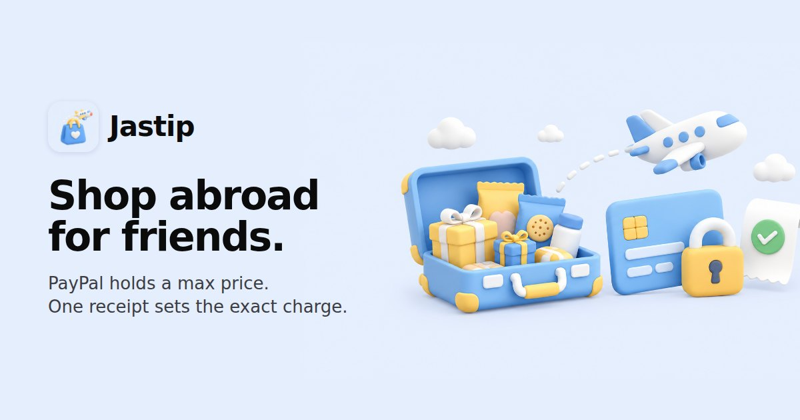

<p align="center"></p>

# Jastip

**Shop abroad for friends. No one pays upfront, no one is overcharged.**

*Jastip* (Indonesian, from *jasa titip*, "carry-for-me service") is how millions of people get
things from abroad: a friend travels, everyone asks for something, and money moves on trust.
Today someone always fronts the money. Either friends pay upfront for items that may be sold out,
or the traveller pays for everything and chases friends afterwards.

Jastip fixes the money part with PayPal:

1. A friend asks for an item and sets a **max price**. AI turns a pasted link or slang into the
   item name and a rough shelf price.
2. The friend approves a **PayPal hold** for the max + the traveller's fee. Nothing is charged.
3. The traveller shops and photographs **one receipt**. AI reads every line and matches lines to asks.
4. Code charges each friend **their exact line + fee** (PayPal partial capture) and **releases**
   every hold for items that weren't found (PayPal void). The AI never sets an amount.
5. Each friend taps **I got my item** at handover: a delivery record for both sides.

**Live demo: https://jastip.feryyp-work.workers.dev** (PayPal sandbox, nothing real is charged)

## For judges

**Try it (about 5 minutes, two browser windows):**

1. Window 1, the traveller: open the live demo, enter a name, tap **New trip**, pick **Tokyo**,
   then **Share trip link** → copy.
2. Window 2, a friend (a private/incognito window, or another browser): open the link, enter a
   name, type `matcha kitkat`, tap **Find**, keep the max price, tap **Ask**.
3. Traveller: **Accept**, then **Pick shopping day**.
4. Friend: **Hold with PayPal** → log in with the sandbox buyer below → approve.
   Back in the app: "Hold approved. ¥0 charged."
5. Traveller: **Start shopping** → **Found** → **Pay & scan receipt** → **Use sample receipt**
   (a Don Quijote Tokyo receipt with Matcha KitKat, Tokyo Banana, Hada Labo, Jagarico) → check
   the charges → **Charge**. Or photograph a real receipt.
   The friend sees the exact charge and how much of the hold was never taken; then **I got my item**.

**PayPal sandbox buyer (test money only):** see the testing instructions on the Devpost
submission. Any PayPal sandbox *personal* account also works.

**What to look at:** the app works on phone, tablet and desktop (try the friend on a phone).
The traveller's trip screen lists every PayPal and AI call in **PayPal & AI activity**.

## How PayPal is used

| Step | PayPal API |
|---|---|
| Friend approves a hold | Orders v2 `POST /v2/checkout/orders` (`intent: AUTHORIZE`, payee = traveller), then `POST /v2/checkout/orders/{id}/authorize` |
| Exact charge from the receipt | Payments v2 `POST /v2/payments/authorizations/{id}/capture`, amount = receipt line + fee, `final_capture: true`, idempotency key per hold |
| Item not found, swap skipped, nothing bought | Payments v2 `POST /v2/payments/authorizations/{id}/void` |

Holds are opened per shopping day and charged at the receipt, inside PayPal's 3-day honor period.
We measured that reauthorize is only allowed once, from day 4 to day 29
(`REAUTHORIZATION_TOO_SOON` on day 1), so holds are not opened at trip booking.
See [`spikes/README.md`](spikes/README.md).

## How AI is used

| Where | Model | What it does |
|---|---|---|
| Ask screen | Cloudflare Workers AI, `@cf/google/gemma-4-26b-a4b-it` | Turns a pasted TikTok/shop link or slang ("matcha kitkat otona") into an item name, variant and a rough local shelf price, used to suggest the max price |
| Receipt | same model (vision) | Reads every receipt line (Japanese, Indonesian, English, discounts) and says which line answers which ask, with a confidence |
| Settlement | **code, not AI** | Folds discounts into the line above, caps each charge at the friend's max (or the agreed swap price), adds the fee, never more than the hold. Lines matched to no ask are voided |

**Runs on Cloudflare's free tier** (10,000 Workers AI neurons a day, reset at 00:00 UTC; a receipt
photo costs about 25 to 75, an item lookup a few). To stay inside it: identical item lookups and
identical receipt scans are answered from a cache, each person gets 20 lookups and 6 receipt scans an
hour, the built-in **sample receipt** has its lines stored with the app (only the short text matching
goes to the AI), and if the daily allowance is ever used up the app keeps working: item lookup falls
back to plain text and the receipt sheet says when the reader is back. Holds are never affected.

Measured on 5 synthetic receipts / 20 asks: Gemma 4 on Workers AI 19/20 (about 10 to 12 s per
receipt live). The one miss is a decoy item; the traveller sees every match before anything is
charged, and an item marked Found that isn't on the receipt is flagged with **Retake photo** first.

## Safety rules (enforced in `app/lib/trips.mjs`)

| | Rule |
|---|---|
| S1 | No hold, no shopping: only asks with an approved hold go on the list |
| S2 | A charge is never above the hold, and never above the receipt line + fee |
| S3 | A charge needs a receipt line matched to that ask; everything else is released |
| S4 | A friend can withdraw only before the hold |
| S5 | The traveller accepts each ask before anyone is asked to hold money |
| S6 | A new friend can hold at most $50 in total until a first handover, unless the traveller taps "I know them" |
| S7 | One capture per hold (idempotency key + status check); a retry repeats the saved step, never a new one |
| S8 | Swaps need the friend's tap and can't exceed the max |

Failure handling, all tested: if PayPal fails mid-settlement, each friend's confirmed charge or
release is saved first and **Retry** repeats only the unconfirmed steps with the same amounts; a
receipt plan made before the shopping list changed is refused; a PayPal approval that lands after
shopping started (or after the ask was withdrawn) is recorded and released, never lost.

Not covered: false "not received" disputes after handover (the handover record and receipt are
kept as evidence, the Disputes API is not wired up), and real sign-in (names only; the session is
an opaque random token).

## Run it yourself

Node 22.5+, no runtime dependencies. See [`app/README.md`](app/README.md) for local run,
Cloudflare deploy and all tests.

```sh
cp .env.example .env          # PayPal sandbox app keys + an OpenAI-compatible vision endpoint
cd app && npm start           # http://localhost:5180
```

Tests: `npm test` (29 end-to-end checks against the real PayPal sandbox, needs
`SANDBOX_BUYER_EMAIL`/`SANDBOX_BUYER_PASSWORD`), `npm run test:edges` (failure and race cases),
`npm run test:ui` (browser edge cases), `npm run test:flow` (full 4-person flow at any screen size).
The browser tests need `npm install` (dev dependency `playwright-core`) and Chrome (`CHROME=/path`).

## Built with

PayPal Orders v2 and Payments v2 (sandbox) · Cloudflare Workers, D1 and Workers AI (Gemma 4) ·
plain JavaScript (no framework, no runtime dependencies) · `qrcode-generator` (MIT, vendored).

## AI tools statement

- **Gemma 4 26B** (`@cf/google/gemma-4-26b-a4b-it`, Cloudflare Workers AI): in the product, for
  item lookup and receipt reading as described above.
- **Gemini 3.8 Flash**: in the product when run locally (any OpenAI-compatible vision endpoint
  works), and to compare models during the receipt spike.
- **OpenAI image generation** (through the Codex CLI): all illustrations, avatars, the app icon
  and the hero image in `app/public/img/` (see [`app/public/img/README.md`](app/public/img/README.md)).
- **AI coding agents** (Claude via the pi coding agent; GPT via pi for independent code and UX
  review rounds, saved in `council/`): used to write and review code, tests and docs. The product
  idea, the PayPal flow, the safety rules and every design decision were made and checked by the author.

## Repository

| Path | What |
|---|---|
| `app/` | The app: `lib/` (API, rules, PayPal, AI, DB), `public/` (UI), `test/`, `migrations/` |
| `spikes/` | The two risk spikes run before building (PayPal holds in JPY, receipt matching) |
| `receipts/` | Synthetic test receipts and their generator |
| `design/`, `proto/` | Design research and clickable prototypes explored before the app |
| `council/` | Independent review rounds of the app (findings and fixes) |

## License

[MIT](LICENSE)
